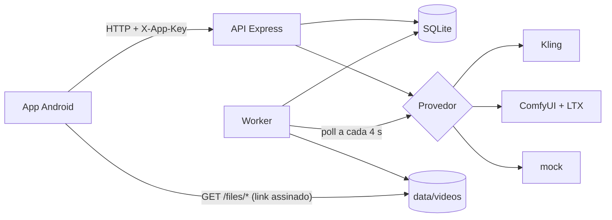
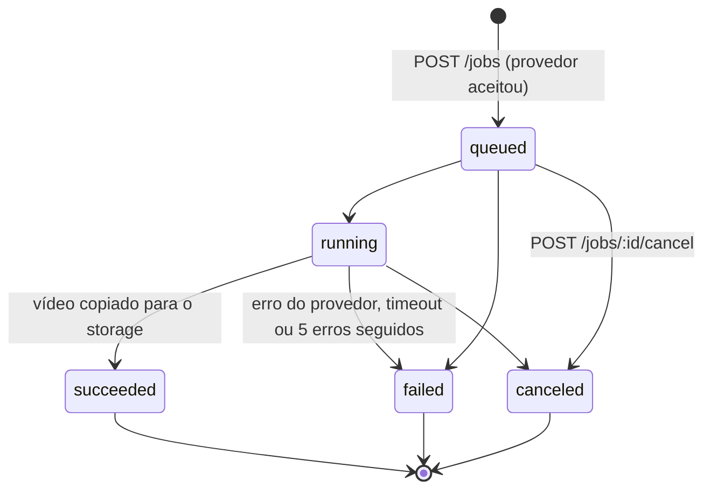

# Arquitetura

## Ciclo de vida de um job

## Decisões

| Decisão | Motivo |
|---|---|
| API própria entre app e provedor | Chaves ficam no servidor; dá para trocar/combinar provedores, limitar custo e registrar histórico sem atualizar o app |
| Job assíncrono + worker | Geração leva de dezenas de segundos a minutos; o app não segura conexão aberta |
| Worker consulta (polling) | Funciona com qualquer provedor, inclusive o ComfyUI local; webhooks ficam como evolução |
| Copiar o vídeo para o nosso storage | URLs de provedor expiram (a Kling limpa saídas após um prazo) |
| Fallback para URL remota se o download falhar | O usuário ainda assiste; o erro fica no log |
| `Idempotency-Key` no `POST /jobs` | Retentativa de rede no celular não cobra duas vezes |
| `GET /capabilities` | O app monta a UI a partir do que o provedor suporta |
| `DAILY_LIMIT` por usuário | Teto simples de custo |
| Chaves por usuário (`APP_KEYS`) | Isola histórico e cota sem montar um sistema de login completo |
| Links assinados com validade para `/files` | O ExoPlayer não envia header; a URL carrega a autorização e expira |
| Entradas persistidas + `seed` efetiva sempre registrada | Permite "refazer"/"variar" e reproduzir resultados |
| Aprimorador opcional via LLM | Melhora o prompt no estilo de cada modelo; desligado sem chave |
| Contrato OpenAPI testado | O cliente (Android) e a API não divergem sem o CI avisar |
| Logs JSON, `/metrics`, encerramento limpo | Operar em Docker/Kubernetes com confiança |
| Migrações versionadas | Evolui o esquema sem apagar o histórico |
| Pool de workers + eventos SSE (`/jobs/:id/events`) | Jobs independentes em paralelo; clientes reagem às mudanças de estado pushadas (sem re-pollar) |
| Provedor agregador genérico (fal, Replicate, Civitai API…) | Provedor por config de ambiente (URL, auth, endpoints, mapping de id/status/URL); surge como `generic-*` em `/capabilities` |
| SQLite via `node:sqlite` | Zero dependência nativa; troque por Postgres se virar multiusuário |
| Provedor guarda o necessário no id | O id sobrevive a reinício (ex.: `image2video:<task_id>` na Kling) |

## Limites conhecidos

Um único processo (worker no mesmo servidor), autenticação por chave (sem cadastro/senha), sem notificação push. Veja o [roadmap](roadmap.md).
